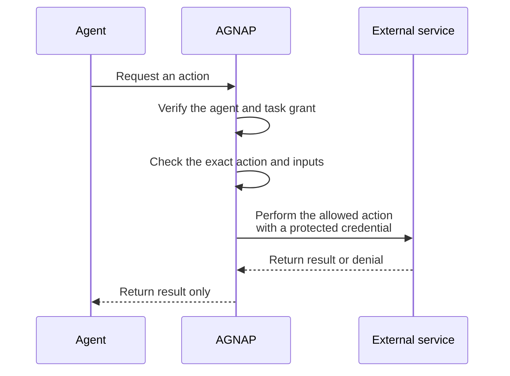
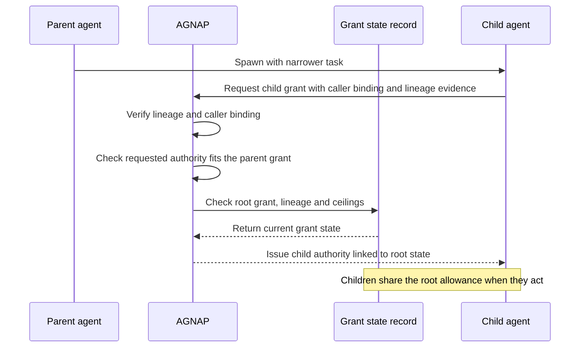

# AGNAP

**Agent Grant Negotiation and Authorization Protocol**

_A grant, not a credential._

AGNAP is an open project exploring how to give an agent permission for a specific
task and enforce that permission outside the agent's control. It combines
structured permissions, checks on each requested action, and a protected
execution boundary.

GNAP is the first authority protocol used by the project. The architecture also
proposes a local authority provider and considers AAuth and OAuth-based alternatives.

**Status:** proposal and specification under development, with a working
proof of concept: a GNAP authorization server, the owner CLI
(`agnap-owner`), the executor (`agnapd`) with the grant state record, and a
DeepSeek Harness plugin. Child grants are not built yet. This README
describes the intended architecture and its security requirements.

## The problem

An owner asks an agent:

> Read the issues in `acme/docs` and summarize them. Ask me before posting a comment.

The available service credential may also permit writing comments, editing
issues or accessing other repositories. Keeping that credential out of the
model's prompt does not restrict what a tool can do with it.

The desired behavior is straightforward:

- Reading issues in `acme/docs` is allowed.
- Reading another repository is denied.
- Posting a comment needs additional permission.
- Cancelling the task prevents subsequent authorized calls.
- The agent receives results without receiving the service credential.

AGNAP's goal is to enforce those decisions even if the agent ignores its task
instructions or bypasses a runtime approval hook.

Runtime tool approval can collect intent, but it is not an enforcement boundary
unless every effect passes through it and the decision is bound to the exact
request.

The core authorization question is:

> Which agent instance may perform which operation, on which resource, under
> which constraints, and what may it delegate?

## How the design works

The owner approves a permission record, or **grant**, for a task. A trusted
component identifies the calling agent session. Before an action runs, an
evaluator checks its operation and inputs against the grant. Only then does a
protected executor use the downstream credential.



This simplified view groups the following roles under AGNAP:

| Component          | Responsibility                                                                              |
| ------------------ | ------------------------------------------------------------------------------------------- |
| Owner              | Requests the task and approves permissions, directly or through standing policy             |
| Agent runtime      | Runs the agent, requests permission and sends tool calls                                    |
| Authority provider | Establishes approved permissions, their lifetime and revocation state                       |
| Evaluator          | Checks a concrete action against the approved permissions; called at the execution boundary |
| Executor / gateway | Blocks or performs the action and protects service credentials                              |
| Tools / services   | Perform operations using their existing APIs and authentication                             |

## Execution boundary

AGNAP is independent of any tool protocol or execution framework. A protected
execution boundary maps a concrete request to the granted operation, verifies
the caller and exact effect, protects downstream credentials, and fails closed
when authorization cannot be established. The checked request must remain
unchanged through execution. The boundary must remain outside agent control and
mediate every path capable of producing the protected effect.

See the [execution boundary contract](docs/execution-adapters.md) for detailed
requirements.

## Authority model

An effective authorization decision combines four things:

1. **Instance binding:** which verified key or protected local session is
   presenting the request, and which executor it is authorized to use.
2. **Granted authority:** the approved operations, argument constraints,
   validity window and any ceiling definitions for that instance.
3. **Grant state record:** expiry and revocation, plus ancestor state and the
   calls counted against the grant's ceilings across a delegation tree.
4. **Execution authority:** executor policy and the downstream credential's
   own permissions.

With GNAP, the agent carries a key-bound token containing or referencing the
granted authority. With the local provider, the broker retrieves a protected
permission record associated with the session. The agent cannot edit either
form of authority. Revocation and the grant state record remain on the trusted side.

### Operation permissions

The `agent_operation` access type names allowed operations and constrains
their inputs. For example:

```json
{
  "type": "agent_operation",
  "operations": {
    "github.issue.read": {
      "repository": { "exact": "acme/docs" }
    }
  }
}
```

`github.issue.read` is an illustrative application-defined name. An adapter
maps the actual request to it. Operations and arguments not named in the grant
are denied. Required fields and types are validated against the tool schema;
the permission checker does not replace that schema.

Each constraint type defines validation and containment: whether one permission
description is no wider than another. Ceilings on calls or spending are
checked against the grant state record, which needs mutable state and atomic
reservations.

## Why GNAP, and where other providers fit

[GNAP](https://www.rfc-editor.org/rfc/rfc9635.html) provides structured access
requests, client-instance keys, owner interaction and an ongoing grant
continuation mechanism. Those features make it AGNAP's first authority protocol.
The GNAP profile uses continuation to request changed permissions as work
evolves; additional authority still requires an authorization decision.

GNAP requires a client key for grant requests and key-bound continuation tokens.
It also permits bearer resource access tokens. The proposed AGNAP
GNAP profile chooses key-bound tool tokens and a distinct key per agent session;
that session mapping is an AGNAP choice.
[RFC 9767](https://www.rfc-editor.org/rfc/rfc9767.html) supplies the resource-server
connections used for token validation.

GNAP leaves decision policy to the server: issue the requested access, issue a
narrower subset, wait for the owner, or deny. Changing that policy does not
require changing the protocol.

[AAuth](https://datatracker.ietf.org/doc/draft-hardt-oauth-aauth-protocol/) and an
OAuth-based provider are alternatives where portable authority is needed.
Provider mappings must preserve proof and lifecycle rules without widening
permissions. Either GNAP or AAuth can sit behind a gateway while downstream
services retain their existing authentication.

## Delegation narrows authority

A parent requests the permission its child needs. The authority provider checks
that request against the parent's grant, owner rules, maximum depth and trusted
lineage evidence. Each child has its own key and grant in the GNAP deployment,
or a separately protected session binding with the local provider.



The owner can permit automatic approval of contained child requests or require
approval for each one. Both modes enforce containment, depth and the root grant's ceilings.
A child wider than its parent is denied. If more authority is needed, the
system must obtain a new owner decision through an explicit root-authority
change; it cannot place wider authority beneath an unchanged, narrower parent.

Children reference the root's grant state record rather than receiving copies
of a spending or call allowance. The executor reserves allowance atomically before
an effect, then records confirmed use or releases it after confirmed failure.
An unknown outcome keeps the reservation until reconciliation. Retries require
service-specific idempotency or reconciliation; a timeout is not proof that an
operation failed.

See the [detailed delegation sequence](docs/delegation.md).

## Related work

These systems and research inform the proposal, supply potential components and
provide comparison targets. Evaluate caller binding, task scope, credential
custody, delegation and accounting against concrete effects; their combination
must not be assumed unique to AGNAP.

- [Attenuating Authorization Tokens (AAT)](https://datatracker.ietf.org/doc/draft-niyikiza-oauth-attenuating-agent-tokens/):
  narrowing authority through agent delegation chains; a reference for
  containment and portable authority.
- [Credential Delegation Protocol](https://datatracker.ietf.org/doc/draft-sweeney-wimse-credential-delegation/):
  credential delegation across systems, directly relevant to the protected executor.
- [Delegation Without Trust](https://arxiv.org/abs/2609.00267):
  identity, authorization and runtime governance research informing tests of
  compromised children, caller binding and replay.
- [AAuth](https://datatracker.ietf.org/doc/draft-hardt-oauth-aauth-protocol/):
  a close architectural alternative and potential provider for mission-based
  authorization, also deployable behind a gateway.
- [Caracal](https://github.com/Garudex-Labs/caracal):
  a reference for authority, narrowing delegation, revocation and audit; compare
  its sessions with runtime-observed instances and task state.
- [Amazon Bedrock AgentCore Policy](https://docs.aws.amazon.com/bedrock-agentcore/latest/devguide/policy-core-concepts.html):
  gateway-enforced policy and temporal sessions; a reference for argument checks
  and session accounting.

## Design documents

AGNAP separates shared authority semantics from provider-specific protocols.
Each guarantee must be attributed to the protocol, runtime, execution boundary
or downstream service that enforces it.

- [Execution boundary contract](docs/execution-adapters.md) — request binding,
  credential isolation and fail-closed enforcement requirements.
- [Authorization and execution sequence](docs/operation-flow.md) — the
  GNAP-oriented owner, runtime, authority and downstream-service roles.
- [Delegation design](docs/delegation.md) — proposed child-grant, lineage and
  shared-state behavior.

Provider mappings require explicit caller-binding and lifecycle semantics; they
must not be inferred by dropping key checks from the GNAP profile.

## Participate

Feedback is welcome on threat models, operation profiles, runtime identity,
local isolation and reproducible enforcement tests. Use
[GitHub Issues](https://github.com/daevmithran/agnap/issues) for proposals and
architecture discussions. Follow [CONTRIBUTING.md](CONTRIBUTING.md) and the
[Code of Conduct](CODE_OF_CONDUCT.md).

Report vulnerabilities through [SECURITY.md](SECURITY.md).

## Funding and collaboration

The project seeks grant support and institutional collaborators for
specification development, interoperability and independent security
evaluation. A possible Internet-Draft would address demonstrated
interoperability needs.

## License

[Apache License 2.0](LICENSE).
