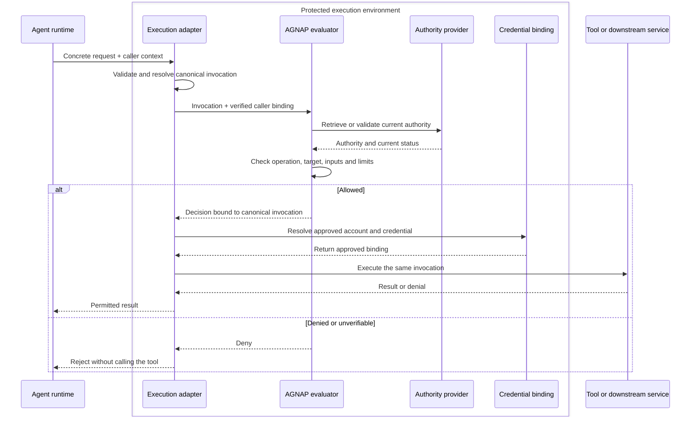

# Execution adapter contract

## Purpose

An AGNAP execution adapter turns a concrete tool request into a checked
operation and preserves that decision through execution. It can expose MCP,
HTTP, CLI or another interface. The interface and dispatch library are
deployment choices, not part of AGNAP's authority protocol.

This document describes the shared security contract for adapters. It is a
design input for implementations and profiles, not a claim that every adapter
listed here exists today.

## Separation of roles

| Role               | Responsibility                                                                                  |
| ------------------ | ----------------------------------------------------------------------------------------------- |
| Authority provider | Establish and maintain the task permission approved by the owner                                |
| Caller binding     | Prove which agent instance or protected session made the request                                |
| Execution adapter  | Resolve the concrete request, obtain an authorization decision and preserve it through dispatch |
| Evaluator          | Check the resolved operation and inputs against current authority                               |
| Credential binding | Select an approved downstream account and destination on the trusted side                       |
| Tool or service    | Perform the effect using its existing API and authentication                                    |

GNAP is the first authority protocol implemented by AGNAP. A protected local
permission store or another authority protocol can fill the authority-provider
role if it preserves the same caller-binding, lifecycle and narrowing rules.
Likewise, MCP, HTTP, CLI and UTCP are possible execution integrations; none of
them creates task authority by itself.

## Required behavior

Every adapter must:

1. identify the caller using a verified key or a protected session channel;
2. resolve a canonical invocation containing the operation, target, parameters
   and any payload or input digest relevant to the effect;
3. validate the request against the pinned tool or API schema;
4. obtain current authority and check the complete canonical invocation;
5. resolve the downstream credential and account only through a trusted binding;
6. dispatch the same immutable invocation that was checked; and
7. reject the request without an external effect if any required step fails.

The adapter must derive security-relevant facts where possible. For example, a
repository patch adapter checks the submitted patch and resulting paths instead
of trusting an agent-supplied list of changed files. A body-bearing HTTP adapter
binds authorization to the body bytes or a verified digest of those bytes.

Authorization cannot be followed by an unchecked rewrite. Defaults, aliases,
redirects, environment variables, working directories, plugin configuration and
other inputs that can change the effect must be resolved before the decision or
constrained as part of dispatch.

## Execution sequence

The protected environment can be one broker process plus isolated workers or a
network gateway and authorization service. The topology is less important than
complete mediation, credential isolation and preventing agent-controlled code
from changing the checked request.

## Adapter forms

### MCP

A protected MCP server can map each tool name and its validated arguments to an
AGNAP operation. Alternatively, a gateway can verify and authorize the original
request before forwarding it to an MCP backend. Tool discovery is not permission
to invoke a tool, and an unmodified MCP client does not automatically supply an
AGNAP caller proof or grant.

An MCP adapter must cover alternate call paths, nested tool calls and any
server-side defaults that affect the target. Unknown tools or arguments fail
closed when AGNAP enforcement is enabled.

### HTTP and network gateways

An HTTP adapter can run in a reverse proxy or API gateway. The signature or
protected channel must bind the method, target URI, authorization context and
body digest as required by the selected authority profile. The gateway must
reject the call when its external authorization service is unavailable.

[agentgateway](https://agentgateway.dev/) is one possible enforcement point. It
is not required by AGNAP, and its external-authorization integration must still
preserve the original checked request and protect backend credentials.

### CLI

A CLI adapter supports reviewed command profiles, not arbitrary credentialed
shell execution. It resolves the binary, arguments, environment, working
directory, configuration, file inputs, hooks and helpers that can affect the
operation. Supported familiar commands such as `gh`, `git` or `kubectl` can be
forwarded through a shim to constrained workers. Unsupported invocations are
denied.

### UTCP-backed execution

[UTCP](https://www.utcp.io/) is a candidate dispatch library for an adapter that
needs multiple tool protocols. It may reduce connector code, but it does not
issue AGNAP grants, make authorization decisions or supply the isolation
boundary. Its manuals, plugins, destinations and command templates must be
pinned and reviewed on the protected side.

Selecting UTCP is an implementation choice. An MCP server, HTTP gateway, custom
connector or another multi-protocol library can implement the same adapter
contract.

## State, retries and multi-step tools

An allow decision applies only to the resolved invocation for which it was
made. Shared call or spending limits require an atomic reservation before the
effect. Confirmed success settles the reservation; confirmed absence of an
effect can release it; an unknown outcome remains held for reconciliation.

A timeout is not proof that an effect did not occur. Adapters must not retry a
non-idempotent action automatically unless the downstream system supplies a
stable idempotency mechanism. Multi-step tools need an explicit authorization
and accounting model for every possible external effect.

## Current integration status

| Integration                         | Status                                                                              |
| ----------------------------------- | ----------------------------------------------------------------------------------- |
| DeepSeek Harness pre-execute plugin | Implemented proof of concept; the plugin and dispatcher currently share one process |
| MCP execution adapter               | Planned; open to independent implementations                                        |
| HTTP gateway adapter                | Planned; agentgateway is one candidate                                              |
| Reviewed CLI broker                 | Planned                                                                             |
| UTCP-backed adapter                 | Candidate for evaluation, not selected                                              |

Before an adapter is described as enforcing AGNAP, tests should show that
permitted calls reach the intended target, denied or wrongly bound calls cause
no downstream invocation, credentials remain unavailable to the agent, and a
post-authorization change cannot alter the approved effect.
